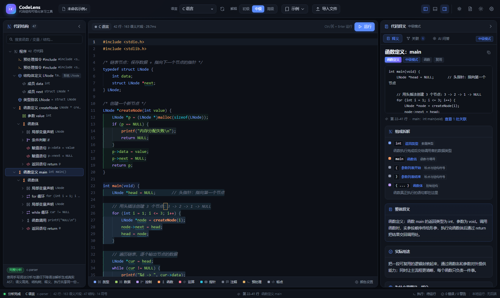
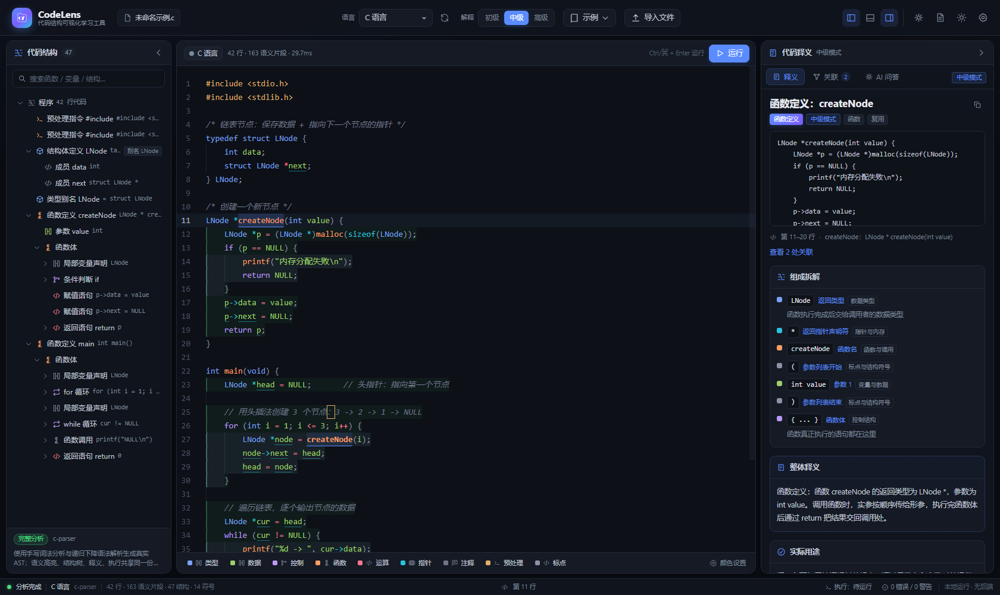
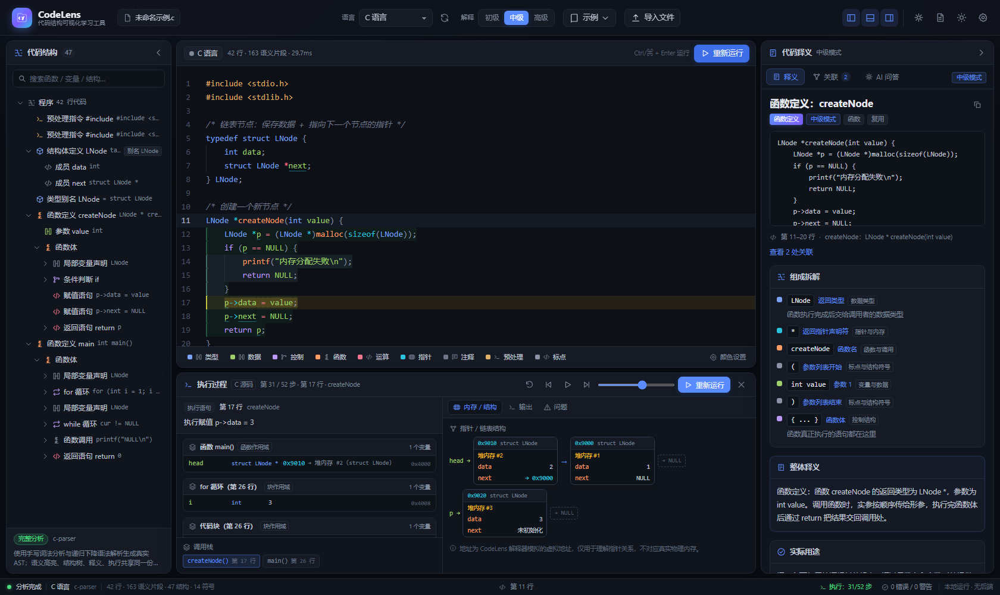
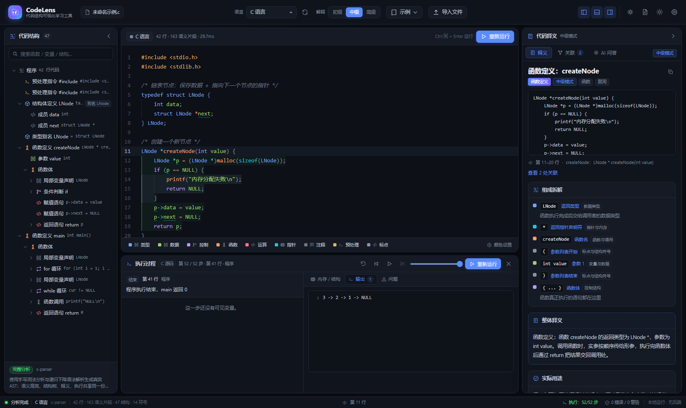
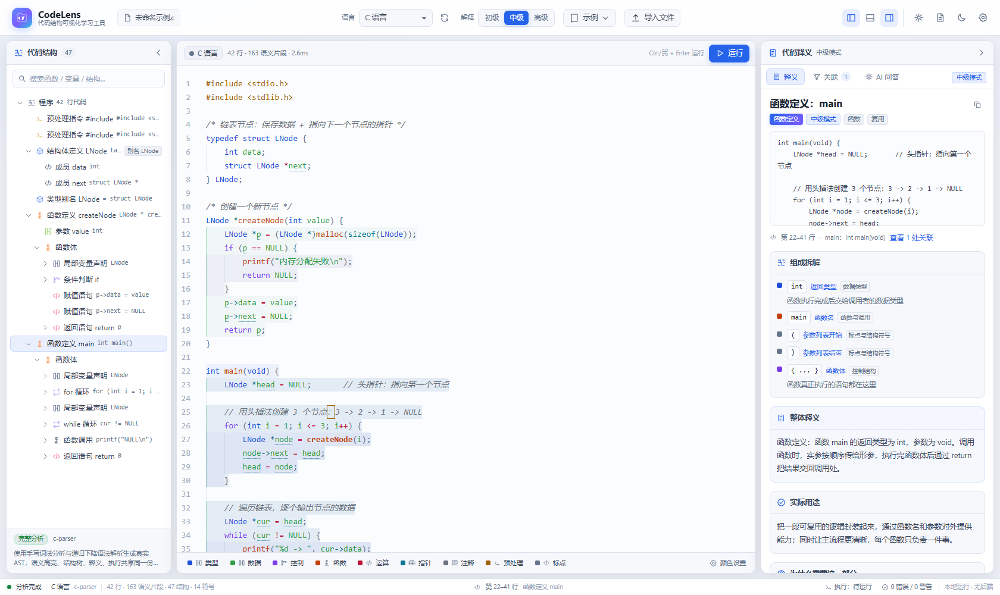
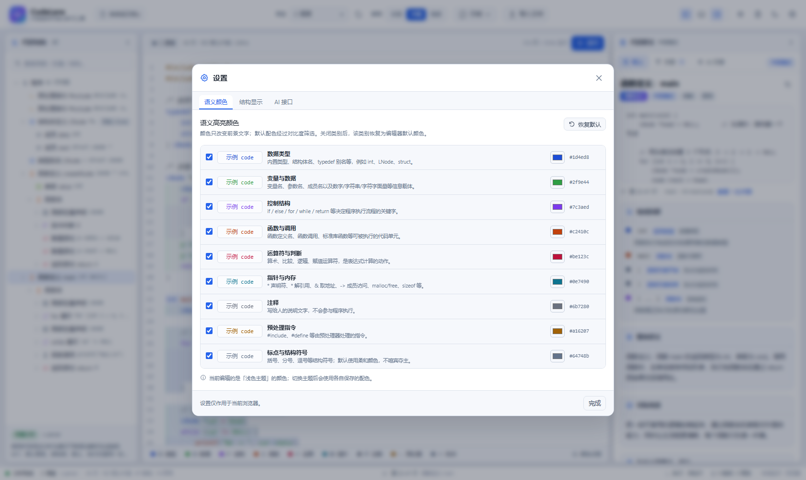
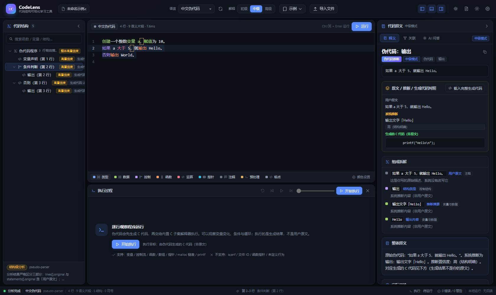

# CodeLens · 代码结构可视化学习工具

> 看得见结构的代码阅读器：**语义高亮 + 结构树 + 中文释义 + 逐行执行可视化**。
> 纯前端运行，不依赖后端；面向编程初学者，也适合教师课堂演示。



CodeLens 是一个运行在浏览器里的代码学习工具。它不会替你"运行一下猜结果"，而是先把代码**拆开**：每个词属于什么语义、每一行处于什么结构、变量与函数怎么关联、程序一行行执行时内存里发生了什么。所有分析都来自真实的词法/语法解析与内置解释器；遇到不支持的语法或能力，界面会明确告诉你原因，**不猜测、不伪造**。

---

## 目录

- [核心功能](#核心功能)
- [界面说明](#界面说明)
- [快速开始](#快速开始)
- [使用指南](#使用指南)
- [三种解释深度](#三种解释深度)
- [技术架构](#技术架构)
- [目录结构](#目录结构)
- [支持语言与能力边界](#支持语言与能力边界)
- [测试与验证](#测试与验证)
- [AI 接口与隐私](#ai-接口与隐私)
- [已知限制](#已知限制)
- [文档与后续路线](#文档与后续路线)

---

## 核心功能

| 功能 | 说明 | 适用语言 |
| --- | --- | --- |
| **语义高亮** | 按"语义角色"而非传统语法着色：类型（蓝）、变量与数据（绿）、控制结构（紫）、函数（橙）、运算符（粉）、指针与内存（青）、注释（灰）、预处理（黄）、标点（柔和）。支持按类别开关、深浅主题分别自定义颜色，另有指针/数组下划线、代码块边界背景与嵌套层级提示。 | C / C++ 子集、JS / TS、Python、伪代码、纯文本（能力递减） |
| **中文结构树** | 把程序组织成中文结构树：程序 → 结构体 / 函数定义 → 参数 / 函数体 → 变量 / 条件 / 循环 / 调用……支持搜索、折叠、点击定位；底部标注分析引擎与能力边界。 | 全部受支持语言 |
| **三种深度中文释义** | 点击任意代码或结构节点，右侧给出：组成拆解、整体释义、实际用途、为什么需要、与其他代码的关联、初学者误区、生活类比；高级模式额外给出内存/指针/调用栈等底层原理。 | 全部受支持语言 |
| **关联定位** | 点击变量、函数或结构体成员，高亮它的**声明与全部使用位置**；「关联」面板按符号列出位置并支持跳转，也可按名称/类别检索整个文件的符号。 | C / C++ 子集、JS / TS、Python（伪代码不建立符号表） |
| **逐行执行可视化** | 内置 C 子集解释器，单步 / 连续播放 / 进度滑块（可拖动跳转）；展示变量作用域与值变化、地址、堆内存中的数组/结构体/链表与指针箭头、调用栈、`printf` 输出、运行期警告与错误（带行号与中文原因）。 | 仅 C / C++ 的 C 子集；伪代码在生成 C 代码满足条件时可执行"生成代码" |
| **中文伪代码推断** | 用中文描述程序，CodeLens 逐行推断结构并生成 C 代码，**严格区分「用户原文 / 系统推断 / 生成的 C 代码」**；每行带置信度，低置信度与无法识别的行会明确提示；生成代码只作对照展示，不会覆盖你的原文。 | 中文伪代码 |
| **JavaScript / TypeScript / Python 结构分析** | JS/TS 使用 `@babel/parser` 真实 AST；Python 使用自实现分词器 + 缩进结构解析。提供语义高亮、结构树、基础释义、符号关联与语法错误报告，**不提供执行**。 | JS / TS、Python |
| **本地学习笔记** | 从真实分析结果生成 Markdown 笔记：代码概览、结构、函数与类型、变量、控制流程、关键知识点、解析问题与能力边界、自测问题。支持复制与下载，**不是 AI 编造内容**。 | 全部受支持语言 |
| **AI 问答（可选）** | 接入 OpenAI 兼容的 `/chat/completions` 接口，可针对当前选中代码连续追问；默认关闭。未配置时使用本地规则解释并明确标注「非 AI」，绝不冒充 AI 回答。 | 全部受支持语言 |
| **编辑与导入** | Monaco 编辑器；内置 9 个真实示例；拖拽或选择导入 `.c/.cpp/.h/.py/.js/.ts` 等代码文件（≤ 512KB）；深浅主题、状态栏、快捷键、帮助与能力边界弹窗。 | — |

---

## 界面说明

CodeLens 采用"三栏 + 顶栏 + 底栏"布局，按 `Ctrl/⌘ + B / J / I` 可分别收起左侧结构树、底部执行面板、右侧释义面板。

### 顶栏

从左到右：CodeLens 品牌（点击打开帮助）、当前文件名；语言选择器 + 自动识别、解释深度（初级 / 中级 / 高级）、示例下拉、导入文件；面板开关、AI 问答、学习笔记、主题切换、设置。

### 左栏：代码结构树

按"程序 → 函数 / 结构体 / 类型别名 → 参数 / 函数体 → 变量 / 条件 / 循环 / 调用"展示中文结构，每个节点带代码位置与补充说明。支持搜索过滤、逐级折叠、点击后编辑器滚动并选中对应代码。底部固定显示当前分析引擎与一段能力说明。

### 中栏：代码编辑器 + 语义图例

Monaco 提供编辑体验，CodeLens 在它之上叠加语义装饰：字色、指针/数组下划线、结构边界背景、选中结构高亮、关联符号高亮、当前执行行高亮。编辑器底部是九类语义图例，点击任意类别即可开关该类高亮，「颜色设置」进入配色面板。工具栏显示当前语言、行数、语义片段数、解析耗时、错误/警告数以及「运行」按钮。



### 右栏：释义 / 关联 / AI 问答

- **释义**：当前点击片段的结构化中文解释，顶部可切换解释深度。
- **关联**：当前符号的声明与全部使用位置，可点击跳转；未选中符号时可检索本文件全部符号。
- **AI 问答**：基于当前代码与选中片段的连续问答；未配置 API 时只能得到本地规则解释。

### 底部：执行过程面板

运行后打开，包含：播放控制（重置 / 上一步 / 自动播放 / 下一步 / 进度滑块 / 重新运行）、当前执行语句与中文说明、变量作用域表、调用栈、内存/结构图（数组元素、结构体成员、堆对象、指针箭头与链表）、输出控制台、问题列表。内存地址是 **CodeLens 解释器模拟的虚拟地址**，只用于理解指针关系，不对应真实物理内存。





### 底栏：状态栏

显示分析状态、语言与分析器、行数/语义片段/结构/符号统计、当前选中行、执行进度、错误与警告数，以及"本地运行 · 无后端"提示。

### 浅色主题与设置





---

## 快速开始

### 环境要求

- **Node.js**：满足 Vite 8 的 `engines` 要求 `^20.19.0 || >=22.12.0`（即 20.19+ 的 20.x，或 22.12+）。本项目在 **Node 24.21 + pnpm 11.28** 下验证
- **pnpm**（推荐最新稳定版；锁文件为 `pnpm-lock.yaml`）
- 现代浏览器：Chrome / Edge / Firefox 等（Monaco 使用 Web Worker；AI 与剪贴板功能在 `localhost` 下可用；本项目浏览器验收使用 Microsoft Edge）
- 运行浏览器验收脚本时，另需系统安装 **Microsoft Edge**（见[测试与验证](#测试与验证)）

### 安装与启动

```bash
# 1. 进入项目目录（当前工作目录为 D:\CodeLens）
cd D:\CodeLens

# 2. 安装依赖（首次运行；依赖已安装可跳过）
pnpm install

# 3. 启动开发服务器（配置文件固定 127.0.0.1:5173）
pnpm dev
# 打开 http://127.0.0.1:5173
```

> 端口说明：`vite.config.ts` 指定 `host: 127.0.0.1`、`port: 5173`。若 5173 已被占用，Vite 会自动改用下一个可用端口，请以终端输出为准。

### 常用命令

| 命令 | 作用 |
| --- | --- |
| `pnpm dev` | 启动 Vite 开发服务器 |
| `pnpm build` | 类型检查（`tsc -b`）后生产构建，产物在 `dist/` |
| `pnpm preview` | 本地预览生产构建（默认 http://localhost:4173） |
| `pnpm test` | 用 Vitest 运行全部单元测试（`tests/**/*.test.ts`） |
| `pnpm test:watch` | Vitest 监听模式 |
| `pnpm typecheck` | 只做类型检查，不产出 JS（可能更新 `tsconfig.tsbuildinfo` 构建缓存，已被忽略） |
| `node scripts/verify-ui.cjs` | 浏览器实机验收（需先启动 `pnpm dev`，详见下文） |

生产构建是**纯静态文件**：`pnpm build` 后把 `dist/` 交给任意静态服务器即可运行，不需要后端、数据库或 API 服务。

---

## 使用指南

### 1. 打开一个示例

点击顶栏「示例」，选择内置样例（单链表、指针交换、数组统计、递归阶乘、结构体、伪代码、JS、Python）。默认示例是「单链表：创建与遍历」，右侧自动解释 `main` 函数。

### 2. 读懂一段代码

- 直接在编辑器中点击任意标识符或语句，右侧出现对应释义；鼠标悬停会出现简短提示。
- 点击变量名：编辑器高亮它的声明与所有使用位置；右侧「关联」页可跳转到任一位置。
- 点击左侧结构树节点：编辑器定位并选中对应代码区间。

### 3. 观察执行

切换到 C 示例，点击编辑器工具栏「运行」或底部执行面板的「开始执行」（快捷键 `Ctrl/⌘ + Enter`），使用播放控制逐行观察。建议在链表示例中执行到 `p->data = value;` 附近，观察堆对象与指针箭头。

### 4. 试试中文伪代码

把语言切换到「中文伪代码」，输入：

```text
创建一个整数变量 a，赋值为 10。
如果 a 大于 5，就输出 Hello。
否则输出 World。
```

CodeLens 会展示原文 / 推断 / 生成的 C 代码三方对照，并标注置信度。生成代码只作对照参考，不会覆盖你的原文；当前版本尚未提供"一键载入完整生成代码"的按钮，执行伪代码时使用的是系统生成并交给内置解释器的 C 代码。



### 5. 生成学习笔记

点击顶栏「学习笔记」，可预览并复制/下载 Markdown 笔记。内容全部来自当前分析结果，不是 AI 生成的虚构内容。

### 6. 快捷键

| 快捷键 | 作用 |
| --- | --- |
| `Ctrl/⌘ + Enter` | 运行 / 重新运行执行可视化（在编辑器内亦可） |
| `Ctrl/⌘ + B` | 显示 / 隐藏左侧结构树 |
| `Ctrl/⌘ + J` | 显示 / 隐藏底部执行面板 |
| `Ctrl/⌘ + I` | 显示 / 隐藏右侧释义面板 |
| `?` | 打开帮助与能力边界 |
| `Esc` | 关闭当前弹窗 / 退出拖拽状态 |

### 7. 导入本地文件

拖拽文件到页面，或点击「导入文件」。支持 `.c`、`.h`、`.cpp`、`.cxx`、`.cc`、`.hpp`、`.py`、`.js`、`.mjs`、`.cjs`、`.jsx`、`.ts`、`.tsx`、`.pseudo`、`.txt`，大小不超过 **512KB**。导入后自动按扩展名与内容识别语言，可再手动切换。

---

## 三种解释深度

顶栏切换「初级 / 中级 / 高级」，同一段代码会得到不同侧重的解释（默认中级）：

| 深度 | 面向 | 讲解重点 |
| --- | --- | --- |
| **初级** | 零基础 | 少用术语，多用生活化类比，解释"这行大概在做什么"。 |
| **中级** | 正在学习语法 | 讲清语法规则、执行流程与代码之间的关系，以及常见用法。 |
| **高级** | 想理解底层 | 补充内存布局、指针与地址、调用栈、函数调用过程等底层原理。 |

无论哪种深度，释义都包含"能力边界说明"：如果当前语言不支持某项能力，会在这里如实写出。

---

## 技术架构

### 总体数据流

```text
                     ┌───────────────────────────────┐
 源码（编辑/导入/示例） │  analyzeCode(code, { language }) │
 ─────────────────────▶│  按语言分发到对应分析器        │
                     └──────────────┬────────────────┘
                                    │ 统一返回 AnalysisResult
                                    ▼
                     ┌───────────────────────────────┐
                     │ Zustand store（全局状态）       │
                     │ code / analysis / 选择 / 执行… │
                     └───┬───────────┬───────────┬────┘
                         │           │           │
              ┌──────────▼──┐  ┌─────▼─────┐  ┌──▼─────────────┐
              │ 语义装饰     │  │ 结构树     │  │ 释义/关联/AI   │
              │ (Monaco)    │  │ (左栏)     │  │ (右栏)         │
              └─────────────┘  └───────────┘  └────────────────┘
                         │
              ┌──────────▼────────────────────────────────────┐
              │ 执行面板：parseC → 内置 C 子集解释器 → 快照序列 │
              └───────────────────────────────────────────────┘
```

一次分析会产出统一契约 `AnalysisResult`（见 `src/core/analysisTypes.ts`）：`tree`（结构树）、`tokens`（语义 token）、`symbols`（符号表）、`issues`（解析问题）、`execution`（执行能力声明）、`capabilities`（能力标记）、`stats`（统计信息）。UI 层只消费这套结构，不为每种语言写一套界面逻辑。

### 各语言分析器

- **C / C++（C 子集）**：`lexer.ts` 手写词法分析 → `cParser.ts` 递归下降解析生成带精确源码区间的 AST → `symbols.ts` 构建作用域符号表并推断表达式类型 → `semantic.ts` / `structureTree.ts` / `explain/cExplainer.ts` 分别产出语义高亮、结构树与释义；同一份 AST 也供 `interpreter/` 逐行执行。
- **JavaScript / TypeScript**：`languages/javascript.ts` 使用 `@babel/parser`（开启 `tokens` 与 `errorRecovery`）做真实 AST 解析，自实现静态作用域分析，产出结构级结果；语法错误通过 `issues` 报告并尽量恢复结构树。
- **Python**：`languages/python.ts` 自实现分词器（字符串/三引号/注释/数字/Unicode 标识符/运算符/缩进）与基于缩进块的结构解析器，不依赖第三方 Python 解析库。
- **中文伪代码**：`pseudo/analyzer.ts` 规则推断逐行结构并维护置信度，`pseudo/codegen.ts` 生成带行号映射的 C 代码；`analyze.ts` 负责把生成代码接上解释器（仅在推断足够可靠时）。
- **未知文本**：`textFallback.ts` 按行与缩进做**有限**结构分析，并明确提示能力边界。

### 为什么手写 C 解析器？

1. **离线可用**：不需要下载 tree-sitter 的 wasm 语法文件，纯前端直接运行；
2. **精确源码区间**：每个 AST 节点都带字符偏移与行列，语义高亮、点击释义、结构树、执行行高亮可以共享同一份位置模型；
3. **面向教学子集**：针对初学者常见代码（变量、指针、数组、结构体、链表、函数、循环、条件、`printf`、`malloc/free`）做定向支持，遇到暂不支持的语法时给出**明确的中文 issue**，而不是静默猜测；
4. **可解释、可执行**：解释器直接遍历 AST 执行，每个快照都能说明"现在执行到哪、内存发生了什么"，而不是针对示例硬编码结果。

### 为什么用 Monaco 装饰而不是内置 tokenizer？

Monaco 内置语法着色是**词法级**的，只能区分"关键字/字符串/注释"等；CodeLens 需要的是**语义级**分类：

- `LNode` 是类型还是变量？`p` 是指针变量还是普通变量？`next` 是结构体成员还是普通标识符？
- 同一个名字在不同位置是声明、引用还是调用？
- 当前点击的符号在哪些行出现？

这些问题只有结合 AST 与符号表才能回答。因此 CodeLens 只向 Monaco 注册语言 id 与编辑配置，关闭其内置着色，改用 `editor/decorations.ts` 生成 `inlineClassName` 装饰。这样还带来几个好处：九类语义颜色可统一配置、可按类别开关、能绘制指针/数组下划线与结构边界背景，并且同一套装饰管线可复用到所有受支持语言。

### 执行引擎

- 入口：`executeC(program, source, { maxSteps })`（`src/core/interpreter/`）。
- 真实解释 AST：变量、表达式、控制流、函数调用与递归、数组、指针、结构体、`malloc/free`、`printf` 等按 C 子集语义执行。
- 每个快照记录：行号、中文说明、作用域与变量值、堆对象、调用栈、输出、警告。
- 内存模型：全局区 `0x1000` 起、栈区 `0x4000` 起、堆区 `0x9000` 起，均为**模拟地址**。
- 默认限制：最多 3000 步（防死循环）、调用深度 100、堆内存 1MiB；超限会明确提示而非静默截断。
- 运行期错误（除零、空指针解引用、数组越界、未初始化变量、递归过深等）与不支持的语法（`scanf`、文件 IO、函数指针、`goto`、C++ 等）都会中止执行并给出中文原因与行号。

### 状态与持久化

- 全局状态由 Zustand 管理（`src/state/store.ts`）。
- 持久化到 `localStorage` 的只有**偏好设置**：主题、解释深度、九类颜色、类别开关、结构显示、面板显隐、AI 设置。
- **源码与分析结果默认不持久化**，刷新后回到内置示例；AI 对话只在当前会话内保留。

### 技术栈

| 层 | 选型 | 版本 |
| --- | --- | --- |
| UI 框架 | React + React DOM | 19.3 |
| 语言 | TypeScript（`strict`） | 7.0 |
| 构建 | Vite + `@vitejs/plugin-react` | 8.3 |
| 编辑器 | Monaco Editor + `@monaco-editor/react`（本地打包，Worker 由 Vite 处理） | 0.57 / 4.7 |
| 样式 | Tailwind CSS 4（`@tailwindcss/vite`）+ 自定义设计变量 | 4.3 |
| 状态 | Zustand（含 persist 中间件） | 5.1 |
| C 解析 | 手写词法分析 + 递归下降 | 项目内 |
| JS/TS 解析 | `@babel/parser` | 8.1 |
| 测试 | Vitest（Node 环境） | 5.1 |
| 浏览器验收 | `playwright-core` + 系统 Microsoft Edge | 1.65 |

---

## 目录结构

```text
CodeLens/
├─ index.html                    # 页面入口（开发时由 Vite 注入脚本）
├─ package.json                  # 脚本与依赖
├─ vite.config.ts                # React、Tailwind、@ 别名、开发端口、Vitest 配置
├─ tsconfig.json                 # strict + bundler 解析 + @/* 路径别名
├─ .github/workflows/ci.yml      # GitHub Actions：安装依赖 → 单元测试 → 生产构建
├─ .vscode/                      # 任务、调试、推荐扩展、工作区设置
├─ docs/
│  ├─ HANDOFF.md                 # 交接文档：状态/环境/文件地图/待办/接手步骤
│  ├─ ROADMAP.md                 # 阶段清单与后续计划
│  ├─ screenshots/               # 实机截图（由 scripts/verify-ui.cjs 生成）
│  └─ fixtures/                  # 验收脚本生成的临时测试文件（已忽略）
├─ public/favicon.svg
├─ scripts/
│  ├─ verify-ui.cjs              # 51 项浏览器实机验收（playwright-core + Edge）
├─ tests/                        # Vitest 单元测试
│  ├─ cParser.test.ts            # C 词法/语法解析
│  ├─ analysis.test.ts           # 语言识别、语义分类、符号、结构树、装饰、管线
│  ├─ pseudo.test.ts             # 中文伪代码推断与代码生成
│  ├─ languages.test.ts          # JS/TS/Python 结构分析
│  ├─ explain.test.ts            # 中文释义与能力边界
│  └─ interpreter.test.ts        # C 子集解释器执行与快照
└─ src/
   ├─ main.tsx                   # React 根节点；先加载 Monaco 环境与样式
   ├─ App.tsx                    # 三栏布局、拖拽导入、全局快捷键、弹窗
   ├─ components/                # 顶栏、结构树、编辑器、释义、执行面板、设置等
   ├─ core/
   │  ├─ source.ts               # SourceFile：换行归一化、行列 ↔ 字符偏移
   │  ├─ lexer.ts                # C 词法分析器（注释/预处理单独保留）
   │  ├─ cParser.ts              # C / C++（C 子集）递归下降解析器
   │  ├─ ast.ts                  # AST 类型、节点索引、遍历工具
   │  ├─ symbols.ts              # C 符号表、作用域、成员类型推断
   │  ├─ semantic.ts             # 语义 token 生成（9 类）
   │  ├─ structureTree.ts        # C 中文结构树
   │  ├─ semanticCatalog.ts      # 语义类别定义与深浅主题默认配色
   │  ├─ analysisTypes.ts        # 统一分析结果契约
   │  ├─ analyze.ts              # 分析管线入口、语言识别、执行目标解析
   │  ├─ textFallback.ts         # 未知文本的有限分析
   │  ├─ explain/                # 中文释义（C 精确释义 + 结构级释义）
   │  ├─ pseudo/                 # 中文伪代码推断 + C 代码生成
   │  ├─ languages/              # JS/TS（Babel）与 Python 结构分析
   │  └─ interpreter/            # C 子集逐行解释器与快照类型
   ├─ editor/decorations.ts      # 分析结果 → Monaco 装饰规格（纯函数）
   ├─ monaco/setup.ts            # 本地 Monaco、主题、语言注册
   ├─ state/store.ts             # Zustand 全局状态与动作
   ├─ services/                  # 示例、文件导入、学习笔记、AI 接口
   └─ styles/index.css           # 设计变量、深浅主题与全部组件样式
```

---

## 支持语言与能力边界

| 语言 | 解析方式 | 语义高亮 | 结构树 | 释义 | 关联 | 逐行执行 | 支持级别 |
| --- | --- | :---: | :---: | :---: | :---: | :---: | --- |
| **C** | 手写词法 + 递归下降 AST | ✅ | ✅ | 完整三种深度 | ✅ | ✅ C 子集解释器 | 完整分析 |
| **C++** | 按 C 子集解析（C++ 专有语法报 issue） | ✅ | ✅ | 完整三种深度 | ✅ | ✅ 仅 C 子集 | 完整分析（C 子集） |
| **中文伪代码** | 规则推断 + 置信度 + 生成 C 代码 | ✅ | ✅ | 基础（原文/推断/生成对照） | — | 条件支持（执行生成的 C 代码） | 结构级 |
| **JavaScript / TypeScript** | `@babel/parser` 真实 AST | ✅ | ✅ | 基础结构级 | ✅ | ❌ 不提供 | 结构级 |
| **Python** | 自实现分词 + 缩进结构解析 | ✅ | ✅ | 基础结构级 | ✅ | ❌ 不提供 | 结构级 |
| **纯文本 / 未知** | 按行与缩进有限分析 | 有限 | 有限 | 有限 | — | ❌ 不提供 | 有限分析 |

### C / C++ 支持范围（重点）

**支持**：预处理指令（保留原文，`#define` 常量供解释器使用）、`typedef` / `struct` / `union` / `enum`（基础）、全局与局部变量（多声明符、指针、数组、初始化列表）、函数定义与声明、参数；`if/else`、`for`、`while`、`do-while`、`switch/case`、`return`、`break`、`continue`；赋值与复合赋值、三元、逻辑/比较/算术/位运算、函数调用、数组下标、`.` 与 `->` 成员访问、取地址/解引用、自增自减、`sizeof`、类型转换；`printf`、`malloc/free`。

**明确不支持**（会以 issue 或执行错误说明，不会静默伪造）：函数指针、位域、`goto`/标签、K&R 风格函数定义、复杂/函数式宏、文件 IO；C++ 的 `class`、`namespace`、`using`、`template`、STL、继承、`new/delete`、`this` 等。C++ 文件目前按 C 子集解析，遇到 C++ 专有语法会报告问题并尽量继续分析 C 部分。

> 完整、实时的能力说明以应用内「帮助 → 能力边界 / 解析问题」和当前分析结果为准；本文档不替代界面提示。

---

## 测试与验证

CodeLens 的验证分两层：**Vitest 单元测试**（核心逻辑）与 **Playwright 浏览器实机验收**（真实页面）。

### 单元测试

```bash
cd D:\CodeLens
pnpm test          # 全量运行（CI 模式）
pnpm test:watch    # 监听模式
```

测试在 Node 环境运行，覆盖：C 词法/语法解析与错误恢复、语言自动识别、语义分类、符号表与关联、结构树、Monaco 装饰规格、统一分析管线、中文伪代码推断与代码生成、JS/TS/Python 结构分析、中文释义、解释器执行快照等。

最近一次实测（2026-11-17）：**6 个测试文件、193 个用例全部通过**。测试数量会随开发变化，请以 `pnpm test` 的实际输出为准。

### 浏览器实机验收（51 项）

`scripts/verify-ui.cjs` 使用 `playwright-core` 驱动**系统安装的 Microsoft Edge**（无头模式），自动检查 51 项：页面与三栏布局、Monaco 语义装饰生效、结构树行数、释义面板、点击代码后释义更新与关联高亮、执行快照与变量面板、链表/堆内存可视化、单步推进、输出控制台、执行结束输出、解释深度切换、语义类别开关、本地文件导入与语言识别、伪代码分析与生成代码、浅色主题、设置弹窗、浏览器控制台无错误、页面无未捕获异常等。

```bash
# 1. 先启动开发服务器（保持运行）
pnpm dev

# 2. 另开终端运行验收
cd D:\CodeLens
node scripts/verify-ui.cjs
# 输出 "51/51 项通过" 即成功（脚本同时把截图写入 docs/screenshots/）
```

注意：

- 脚本中 Edge 路径默认为 `C:\Program Files (x86)\Microsoft\Edge\Application\msedge.exe`；若你的 Edge 安装位置不同，请修改 `scripts/verify-ui.cjs` 顶部的 `EDGE` 常量。
- 可通过环境变量覆盖被测地址：`set CODELENS_URL=http://127.0.0.1:5173`（PowerShell 用 `$env:CODELENS_URL="..."`）。
- 脚本会重新生成 `docs/screenshots/01`–`09` 截图，（文件导入检查使用内存 File 对象，不再生成临时文件）。

---

## AI 接口与隐私

AI 是**可选增强**，默认关闭。CodeLens 不内置任何密钥，也不会在未配置时伪造 AI 回答。

### 配置方式

1. 点击顶栏 AI 图标（或设置 → AI 接口）；
2. 勾选「启用 AI 问答」；
3. 填写：
   - **Base URL**：OpenAI 兼容接口地址，例如 `https://api.openai.com/v1`（CodeLens 会请求 `{Base URL}/chat/completions`）；
   - **模型名称**：例如 `gpt-4o-mini`；
   - **API Key**：`sk-...`；
   - **温度**：0–1；
4. 「测试连接」验证接口可用，再「保存 AI 设置」。

请求使用浏览器 `fetch` 直接发送（纯前端，没有中转服务器）。发送内容为：系统教学提示词 + 当前语言与解释深度 + 完整代码（超过 8000 字符会截断）+ 当前选中片段 + 最近 6 条对话 + 你的问题。请求超时 45 秒，失败原因（包括缺 Key、HTTP 错误、CORS 等）会原样显示。

### 隐私说明

- **所有代码分析、语义高亮、结构树、伪代码推断、C 子集执行都在浏览器本地完成**，CodeLens 没有后端服务器。
- **源码默认不写入 localStorage**；只保存主题、颜色、面板与 AI 设置等偏好。
- **只有当你主动点击提问且 AI 已配置时**，当前代码与问题才会发送到你配置的接口。
- **API Key 保存在本机浏览器 localStorage**（键名 `codelens-preferences`）；共享电脑请勿保存密钥，使用后建议清除。
- 如果浏览器因 **CORS** 阻止请求，请改用支持浏览器跨域访问的代理/网关地址；CodeLens 不会绕过浏览器安全策略。
- 未配置 AI 时，AI 问答使用**本地规则解释**，消息会明确标注「本地规则解释 · 非 AI」。

---

## 已知限制

**能力边界（与界面一致）**

- C / C++ 仅支持 **C 子集**，不支持函数指针、位域、`goto`、K&R 风格定义、复杂宏、文件 IO，以及 C++ 的类、模板、STL、继承、`new/delete` 等；遇到会明确报告。
- **逐行执行仅支持 C/C++ 的 C 子集**（或伪代码生成的可靠 C 代码）：只支持 `printf`/`puts`/`putchar` 输出与 `malloc/free`，`scanf`、文件 IO、其他标准库函数会明确报错；内存地址是模拟地址；有步数/调用深度/堆大小上限。C++ 高级特性无法执行。
- **JS / TS / Python 只做结构级分析**，不提供执行；释义深度为基础结构级。
- **中文伪代码是规则推断**，不保证正确；低置信度与未识别语句会标注，执行的是生成的 C 代码而非原文。
- 未知文本只做有限结构分析，不假装理解语义。

**工程与体验限制**

- **Monaco 体积较大**：当前生产构建主 JS 约 4.8MB，另有 Monaco Worker（其中 TypeScript Worker 约 6.6MB）等资源，首次加载偏慢；这是后续优化项（见 [docs/ROADMAP.md](docs/ROADMAP.md)）。
- **语言自动识别是启发式规则**，可能误判（例如无扩展名的 JS 代码中包含 `class` 时可能优先命中 C++ 特征），可在顶栏手动切换语言。
- **没有 git 仓库与远程仓库**；协作者接手前建议先初始化并查看 [docs/HANDOFF.md](docs/HANDOFF.md)。
- **没有服务端账号体系**，笔记与偏好都保存在本机浏览器；换浏览器/清缓存会丢失。
- 界面主要面向桌面宽屏，窄屏已有基础自适应（侧栏浮层化），但**未做移动端实机验证**与触控优化。

---

## 文档与后续路线

| 文档 | 内容 |
| --- | --- |
| [docs/HANDOFF.md](docs/HANDOFF.md) | 交接文档：当前完成状态、运行环境（含本机 Node/pnpm 绝对路径）、文件地图、数据流、验证命令与最近结果、已知问题、上下文耗尽后的接手步骤。 |
| [docs/ROADMAP.md](docs/ROADMAP.md) | 阶段一/二/三完成清单，阶段四增强计划（多语言解析、执行引擎、AI 流式、笔记导出、移动端等）、建议实现顺序与风险。 |

如果你准备参与开发，建议先读 `docs/HANDOFF.md`；如果你只是想使用，按[快速开始](#快速开始)启动即可。

---

## 设计原则

CodeLens 在实现上坚持三条原则：

1. **不伪造**：不支持的语法、不能执行的语言、失败的请求都明确说明，绝不返回编造的"分析结果"或"执行结果"。
2. **可解释**：每个颜色、每条释义、每个执行快照都能追溯到 AST、符号表或解释器状态，而不是正则猜测。
3. **教学优先**：中文结构标签、中文错误提示、逐行说明与生活类比，都是为了帮助初学者建立正确的心理模型。

欢迎在此基础上继续扩展：更多语言、更多执行引擎、更丰富的学习材料。具体计划见 [docs/ROADMAP.md](docs/ROADMAP.md)。
